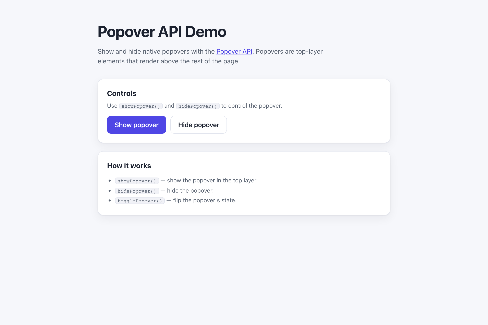

# WebSharper.Popover

[](https://www.nuget.org/packages/WebSharper.Popover)

WebSharper bindings for the [Popover API](https://developer.mozilla.org/en-US/docs/Web/API/Popover_API) —
showing and hiding native HTML popovers from F# and C# web apps.

The Popover API is a Baseline feature in modern browsers. It does not require a secure context, but it does
need a browser that supports the `popover` attribute.

This repository contains:

| Project | Purpose |
| --- | --- |
| `WebSharper.Popover` | The binding: WIG definitions for `HTMLElement`, `HTMLButtonElement`, `HTMLInputElement`, `ToggleEvent`, `ToggleEventInit`, and the popover option dictionaries and enums. |
| `WebSharper.Popover.Sample` | An ASP.NET Core SPA that shows and hides a popover from two buttons. |

## Live demos

**Try it live:** [Open the sample in your browser](https://dotnet-websharper.github.io/popover/)



The sample doubles as the binding's test case: it shows and hides a native popover from F# event handlers.

- **Sample (this repository):** <https://dotnet-websharper.github.io/popover/>
- **Source repository:** <https://github.com/dotnet-websharper/popover>
- **WebSharper bindings:** <https://websharper.com/bindings>

## Features

- `HTMLElement` (`popover`, `showPopover`, `hidePopover`, `togglePopover`, `onBeforeToggle`, `onToggle`).
- `HTMLButtonElement` (`popoverTargetElement`, `popoverTargetAction`).
- `HTMLInputElement` (`popoverTargetElement`, `popoverTargetAction`).
- `ToggleEvent` and `ToggleEventInit` (`newState`, `oldState`).
- `PopoverState` (`auto`, `hint`, `manual`), `PopoverTargetAction` (`hide`, `show`, `toggle`), and `ToggleState` (`open`, `closed`).
- `ShowPopoverOptions` and `TogglePopoverOptions`.

## Installation

```bash
dotnet add package WebSharper.Popover
```

## Usage

```fsharp
namespace WebSharper.Popover.Demo

open WebSharper
open WebSharper.JavaScript
open WebSharper.Popover

[<JavaScript>]
module Demo =
    let popover () =
        JS.Document.GetElementById("myPopover") |> As<HTMLElement>

    let show () = popover().ShowPopover()
    let hide () = popover().HidePopover()
```

The popover element is a regular HTML element with the `popover` attribute. `showPopover()` and
`hidePopover()` are the imperative methods; `togglePopover()` flips the state. `popoverTargetElement`
and `popoverTargetAction` on buttons let the browser handle show/hide without any JavaScript.

## Running the sample

Build the sample in Release and serve its static output:

```bash
dotnet build WebSharper.Popover.Sample/WebSharper.Popover.Sample.fsproj -c Release
python3 -m http.server -d WebSharper.Popover.Sample/wwwroot 8099
```

Open <http://localhost:8099/> and click the buttons to show and hide the popover.

Alternatively, run the ASP.NET Core host:

```bash
dotnet run --project WebSharper.Popover.Sample
```

## Building from source

### Prerequisites

- [.NET SDK 10](https://dotnet.microsoft.com/download) or later.

### Build

```bash
dotnet build WebSharper.Popover.sln -c Release
```

The binding projects target `netstandard2.0`; the sample targets `net10.0`.

## Deployment

Pushing to `main` triggers `.github/workflows/ghpages.yml`, which builds the sample in Release and publishes
`WebSharper.Popover.Sample/wwwroot` to the `gh-pages` branch.

## Repository layout

```
WebSharper.Popover/              # binding (WIG definitions)
  Main.fs
WebSharper.Popover.Sample/       # ASP.NET Core SPA demo
  Client.fs
  Startup.fs
  wwwroot/
    index.html
    site.css
.github/workflows/ghpages.yml      # build + deploy the sample to GitHub Pages
```

## Notes on the API

- **Baseline:** the Popover API is available in modern browsers. Check the compatibility table on MDN before relying on it.
- **`popover` attribute:** the `auto`, `hint`, and `manual` states control how popovers interact with light-dismiss and other popovers.
- **Methods:** `showPopover()` and `hidePopover()` are imperative; `togglePopover()` flips the state. The `ToggleEvent` fires on `beforetoggle` and `toggle`.
- **Declarative:** buttons with `popoverTargetElement` and `popoverTargetAction` can show/hide a popover without JavaScript.

## License

Apache 2.0 — see [LICENSE.md](LICENSE.md).
